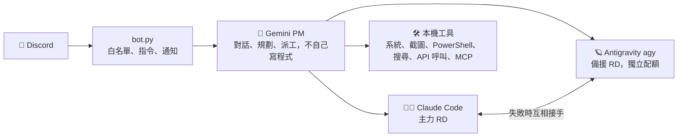
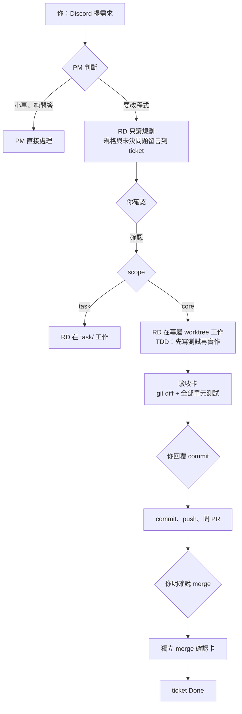

# ArQ 🤖 — 用手機 Discord 遙控 PC 的 AI 助理與開發團隊

<div align="center">

[](https://www.python.org/)
[](https://discordpy.readthedocs.io/)
[](https://ai.google.dev/)
[](https://claude.ai/)
[](LICENSE)

</div>

ArQ 跑在你的 Windows 電腦上。用手機私訊它，就能問問題、看電腦狀態、截圖、下指令，
或交代開發任務：由 **Gemini（PM）** 整理規格，派給兩位 **RD 工程師**（Claude Code、Antigravity）實作，
每個關鍵動作都經過你點頭。



## ✨ 特色

| | |
| :--- | :--- |
| **PM / RD 雙層分工** | Gemini 只當 PM：釐清需求、派工、驗收，**不寫程式也不讀程式**，省 Token 又讓程式碼不進 PM 上下文。寫程式交給 RD：Claude Code 優先，額度用完或出錯由 agy 全新對話接手；逾時但有進展就交回同一位收尾。 |
| **TDD 與人工關卡** | RD 先寫測試再實作；核心修改在專屬 git worktree 內進行，系統自己跑 `git diff` 與全部測試做成**驗收卡**。commit、PR review、merge 是三道各自獨立的人工關卡，同意 commit 不等於同意 merge。 |
| **安全沙盒與權限控制** | 白名單預設拒絕；風險操作（安裝套件、刪檔、改設定、git）一律跳同意卡，**fail-closed**（逾時、例外、無回呼都視為拒絕）；金鑰只在 `.env`，AI 與子程序讀不到，輸出前遮蔽；外部 MCP 工具視為不可信。詳見 [docs/SECURITY.md](docs/SECURITY.md)。 |
| **PC 遠端中樞** | 手機上就能截圖、看 CPU / RAM、執行 PowerShell、重啟 ArQ 或整台電腦（先檢查風險、倒數可取消、開機後回報）、開機自動啟動、背景任務完成主動通知。 |
| **Ticket 驅動** | 以 GitHub Issues 與看板管理需求：派工自動開單、狀態同步、相依與母子單、重複開單攔截。 |
| **可擴充** | 通用 MCP Client 掛載外部工具（每次呼叫預設要同意）、`call_api` 呼叫 REST API、永豐證券唯讀查詢、天氣與搜尋等工具。 |
| **省 Token** | 顯式快取、對話歷史裁切、工具結果摘要、工具宣告瘦身、依任務切換 thinking 等級。 |

## 🔄 開發流程



完整架構圖（系統總覽、訊息流程、RD 派工與換手、模組相依）與設計取捨見 **[docs/ARCHITECTURE.md](docs/ARCHITECTURE.md)**；
指令、設定與各項功能的完整說明見 **[docs/USAGE.md](docs/USAGE.md)**。

## 🚀 快速開始

1. 安裝 [uv](https://github.com/astral-sh/uv)，執行 `uv sync`
2. 複製 `.env.example` 為 `.env`，填入 `DISCORD_BOT_TOKEN`、`GEMINI_API_KEY`、`ALLOWED_USER_IDS`（其餘選填，說明見檔內註解）
3. RD 工程師（選填）：`claude auth login`，並安裝登入 [Antigravity CLI](https://antigravity.google/)；核心修改的 PR 流程需要 [GitHub CLI](https://cli.github.com/)
4. 啟動：`.\run.ps1`（支援 `/reboot` 自動重啟）；開機自動啟動見 `scripts/autostart.ps1`

ArQ 目前只支援 Windows（截圖、PowerShell、整機重啟等功能依賴桌面環境）。

## 🧪 測試

每個 Pull Request 與推送到 `main` 時，GitHub Actions CI 會在乾淨的 Windows 環境中執行全部單元測試；測試全面禁止連外。本機執行：

```powershell
uv run python -m unittest discover -s tests
```

## 📂 結構

```text
bot.py · agent.py · confirm_view.py     Discord 入口、Gemini PM、同意按鈕
tool_registry.py                        PM 的工具註冊表與風險 / 防護函式
prompts/pm_system.md                    PM 系統提示詞
discord_ui/                             Discord 卡片、按鈕與長訊息分段
tools/config.py                         集中路徑與環境設定
tools/chat_store.py                     對話記憶與派工結果跨重啟保存
tools/log_setup.py                      logging 與輪替紀錄檔
tools/thread_bridge.py                  背景執行緒回事件迴圈的通知與同意
tools/rd_dispatch.py (+ rd_context · rd_report · rd_common · rd_jobs)   RD 派工、回報、ticket 脈絡
tools/                                  其他工具（風險判定、機密防護、call_api、MCP client…）
docs/                                   架構圖解、使用說明、資安說明
scripts/                                技能庫同步、開機自動啟動
tests/                                  單元測試
task/ · _temp/                          任務區與執行期狀態（不進版控）
```

開發規範與 AI 協作者交接文件請見 **[GEMINI.md](GEMINI.md)**。授權：[MIT](LICENSE)。

## English

ArQ is a Windows-hosted Discord bot that turns your phone into a remote console for your PC. A Gemini-powered
**PM** agent handles conversation, planning and task dispatch but never writes code itself; two **RD** coding
agents (Claude Code as primary, Antigravity as fallback with automatic hand-off) do the implementation under TDD,
inside isolated git worktrees. Risky actions require explicit approval via Discord buttons (fail-closed), commit /
PR review / merge are three independent human gates, and secrets never reach the model or sub-processes.
See [docs/ARCHITECTURE.md](docs/ARCHITECTURE.md) for diagrams and design trade-offs (documentation is in Traditional Chinese).
