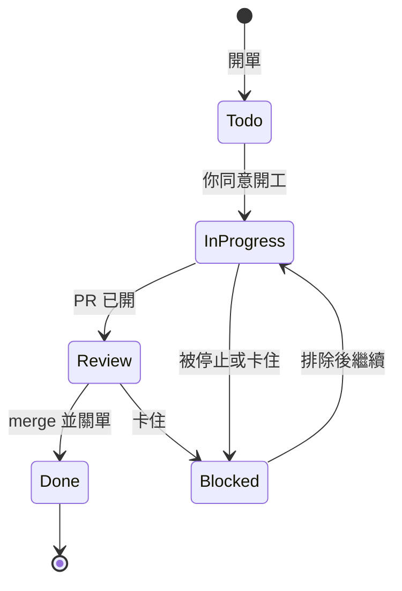

# ArQ 與 Agentic Engineering：概念對應表

ArQ 不只是「會呼叫工具的聊天機器人」，而是把 Agentic Engineering 常見的八個關注點都落實成可測試的程式。
下表從業界通用名詞出發，指出 ArQ 對應的設計與程式位置；圖解見 [ARCHITECTURE.md](ARCHITECTURE.md)，安全面見 [SECURITY.md](SECURITY.md)。

| # | 業界概念 | ArQ 的實作 |
| :-: | :--- | :--- |
| 1 | 階層式多代理人編排 | Gemini PM 當 Orchestrator，Claude Code 與 Antigravity 當 Worker |
| 2 | Agent Harness（宿主環境） | 行程監控、背景佇列、逾時看門狗、自動換手、Discord 介面層 |
| 3 | 上下文工程與隔離 | PM 不讀程式碼、RD 只拿規格化需求、`session_id` 續接、歷史裁切與顯式快取 |
| 4 | HITL 與安全防護欄 | 工具層前置風險攔截、同意卡、fail-closed、三道人工關卡 |
| 5 | 規劃—執行雙階段 | `plan=true` 只讀規劃，使用者裁決後同一位 RD 接續實作 |
| 6 | TDD 自我修正閉環 | 先寫測試、依失敗訊息修正，系統再獨立跑全部測試做成驗收卡 |
| 7 | 受限動作空間 | 風險規則、worktree 隔離、唯讀金融 API、MCP 視為不可信 |
| 8 | 結構化外部記憶與看板 | GitHub Issues 當記憶與狀態機，Projects 看板同步狀態 |

## 1. 階層式多代理人編排（Hierarchical Multi-Agent Orchestration）

- **Orchestrator（PM Agent）**：Gemini 負責意圖解析、任務拆解、派工與轉達，**堅持不寫程式**，也因此不必把龐大的程式碼放進自己的上下文，Token 用量大幅降低。
- **Worker（RD Agent）**：Claude Code 為主力、Antigravity（agy）為備援，各有獨立配額與完整的程式碼編輯能力，構成 Planner–Worker 模式。
- **角色可替換**：派工入口統一走 `run_dev_task()`，哪位 RD 先上、失敗後誰接手都由程式決定，不靠提示詞。
- 位置：`agent.py`、`tool_registry.py`、`tools/rd_dispatch.py`、`prompts/pm_system.md`

## 2. Agent Harness 與宿主環境

Harness 是讓 Agent 能穩定、可觀測、可中斷地跑起來的那層外殼，ArQ 自己實作了：

- **行程監控**：RD 以子行程執行，`Watchdog` 以「閒置 600 秒或總時長 3,600 秒」判斷逾時，等使用者同意的時間不計。
- **背景非同步佇列**：PM 立即回報「已受理」與 job 編號，RD 在背景工作，完成結果進待轉達佇列，最多 2 張單並行（`RD_MAX_PARALLEL`）。
- **失敗換手（Failover）**：額度用完或程序異常由另一位 RD 以全新對話接手；逾時但有進展則不換人，交回同一位收尾一次。
- **可中斷**：🛑 按鈕或 `/stop` 結束整個程序樹，不換手、不自動還原。
- **可觀測**：輪替日誌、Token 用量紀錄（含每輪呼叫的工具名稱）、重啟後恢復對話與未轉達的結果。
- **介面層**：Discord 同時是輸入與輸出，用 Embed、按鈕與卡片承接人機互動。
- 位置：`tools/rd_common.py`、`tools/rd_jobs.py`、`tools/thread_bridge.py`、`tools/chat_store.py`、`tools/log_setup.py`、`bot.py`、`discord_ui/`

## 3. 上下文工程與隔離

- **PM 與 RD 的上下文嚴格分離**：PM 讀 `task/` 以外的程式碼檔或執行 `git diff` 由 guard 直接拒絕；需要了解現有程式時，派 RD 做只讀規劃，PM 只收規格。
- **規格化交接**：RD 收到的是整理過的任務描述，加上程式附上的 ticket 內文與最新規劃留言，而不是整段對話。
- **Session Continuity**：`session_id` 讓規劃、提問、裁決、實作在同一位 RD 的同一條對話內延續；只帶 `session_id` 時，程式會找回原本那張單。
- **預算化的 PM 上下文**：對話歷史只留最近 6 輪、工具結果縮成摘要、系統提示詞與工具宣告走 Gemini 顯式快取；舊脈絡改靠 ticket 查詢，而不是塞進歷史。
- 位置：`tools/rd_context.py`、`tools/rd_dispatch.py`、`tools/gemini_cache.py`、`agent.py`（`trim_history`）

## 4. 人在迴路與安全防護欄（HITL & Guardrails）

- **工具層前置攔截**：每個工具呼叫在執行前先過 `guard`（直接拒絕）與 `risk`（需要同意）。安裝套件、刪檔、改設定、`git commit / push / merge`、重啟系統都會在 Discord 跳同意卡，連 RD 開發途中也一樣。
- **手動工具迴圈**：刻意不啟用 SDK 的自動函式呼叫，否則每一步都無法攔截。
- **fail-closed**：沒有同意回呼、逾時、例外、事件迴圈已關閉，一律視為拒絕。
- **三道獨立的人工關卡**：確認規格才派工 → 確認 commit → review 後確認 merge。同意 commit 不等於同意 merge，merge 必須單獨一行並跳附 PR 資訊的確認卡。
- 位置：`tools/risk_policy.py`、`tool_registry.py`、`confirm_view.py`、`tools/claude_gate_hook.py`

## 5. 規劃—執行雙階段工作流（Plan-and-Solve）

- **唯讀規劃**：`plan=true` 讓 RD 只讀程式碼、不改任何檔案，回傳規格、驗收標準與附建議答案的未決問題，並留言到 ticket。
- **狀態轉換**：使用者裁決後，由同一位 RD 帶入規劃結果轉為實作（`plan=false`），避免未經思考就動手，降低幻覺與返工。
- **高風險先對焦**：`scope=core`、新外部 API 或套件、資料持久化與破壞性操作，PM 一定先列出未決問題才派工。
- 位置：`tools/claude_tools.py`（Claude 以 `--permission-mode plan` 執行）、`tools/rd_common.py`（規劃提示詞）

## 6. TDD 與自我修正閉環

- **Code–Act–Evaluate**：派工規格要求先寫或更新測試、執行測試、依錯誤訊息自我修正，最後附上測試通過的佐證。
- **不只信 Agent 的自述**：核心修改完成後，系統自己對該單的 worktree 跑 `git diff --stat` 與全部單元測試，做成**驗收卡**給人類看。
- **測試本身受保護**：測試全面禁止連外（`tests/netguard.py`）、公開安全掃描、架構文件與程式一致性檢查，全部納入同一套 CI。
- 位置：`tools/rd_report.py`、`tools/rd_dispatch.py`、`tests/`、`.github/workflows/tests.yml`

## 7. 工具擴展與受限動作空間（Sandboxed Action Space）

Agent 能做的事是被刻意收窄的，而不是事後補救：

- **工作區隔離**：`scope=core` 在每張單專屬的 git worktree 內改 ArQ 本身，執行中的資料夾保持在 `main`；`scope=task` 的腳本與產出放在 `task/`（不進版控），並於事後比對 git 狀態偵測越界。
- **唯讀的金融整合**：永豐 Shioaji 只提供餘額、持倉、損益、報價與排行，原始碼中不含下單、改單、刪單呼叫，測試會掃描原始碼。
- **金鑰隔離**：金鑰只在 `.env`，AI 與子行程讀不到，輸出前遮蔽。
- **外部工具不可信**：MCP server 須先核可才啟動、每次呼叫預設要同意、結果標示為外部資料。
- **危險參數不開放**：`cwd`、`timeout`、`approve` 等不給 AI，`scope` 只接受 `task` 與 `core`。
- 位置：`tools/worktree.py`、`tools/shioaji_tools.py`、`tools/secret_guard.py`、`tools/mcp_manager.py`、`tools/http_tools.py`

## 8. 結構化外部記憶與看板專案管理

- **Ticket 即長期記憶**：GitHub Issues 保存任務規格、邊界條件、規劃留言與歷史決策；PM 的對話歷史有限，需要舊脈絡時就查 ticket。
- **有限狀態機**：每張單只有固定幾種狀態，轉換由程式控制而非 Agent 自由發揮。

- **GitHub Projects 看板**：狀態變更時，程式透過 GraphQL 同步移動 Projects v2 看板的欄位，讓人類與 Agent 在同一個看板上看到即時、透明的進度。`Done` 只有對應 PR 已 merge 才允許。
- **相依與母子單**：大型需求可拆成母單與子單並設定相依，有相依的單會被擋下，子單完成後母單自動前進。
- 位置：`tools/ticket_tools.py`（`sync_board_status`）、`tools/rd_context.py`、`.github/ISSUE_TEMPLATE/`

## 延伸閱讀

- [ARCHITECTURE.md](ARCHITECTURE.md)：系統總覽、訊息流程、RD 派工與換手、模組相依，附設計取捨
- [SECURITY.md](SECURITY.md)：資安不變量
- [../GEMINI.md](../GEMINI.md)：開發慣例與給 AI 協作者的交接文件
