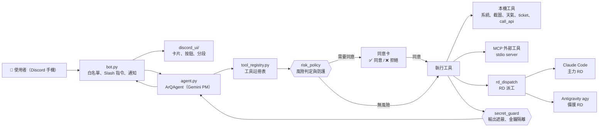
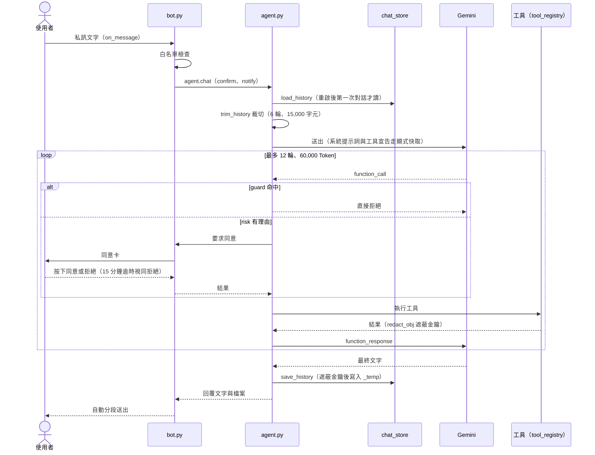
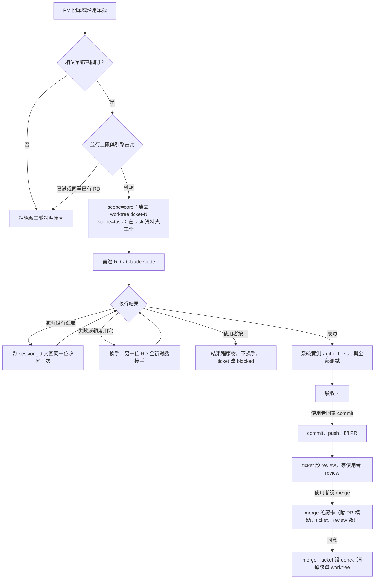
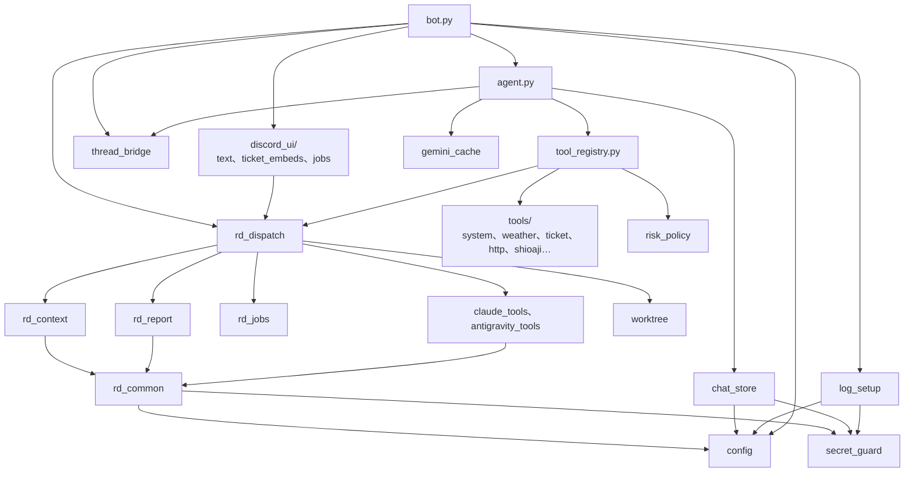

# ArQ 架構圖解

> 四張圖由外而內：系統總覽 → 一則訊息 → RD 派工 → 模組相依。圖一律用 Mermaid，GitHub 直接渲染。
> 規則與細節見 [GEMINI.md](../GEMINI.md)，使用方式見 [README](../README.md)。

## 1. 系統總覽

使用者只和 Discord 說話，`bot.py` 負責身分檢查與指令，真正的對話與決策交給 `agent.py` 裡的 Gemini PM。
PM 本身不寫程式，所有工具都登記在 `tool_registry.py`，每次呼叫先過 `risk_policy` 判斷要不要跳同意卡，執行結果再經 `secret_guard` 遮蔽金鑰後才回到 Gemini 與 Discord。
需要寫程式時由 `rd_dispatch` 交給 Claude Code，失敗或額度用完時由 agy 接手。
**取捨**：把風險判定集中在註冊表前面的單一關卡，而不是讓每個工具各自判斷，新增工具時不會漏掉防護，代價是風險規則是關鍵字比對，只能盡力而為。

## 2. 一則訊息的處理流程

訊息先過白名單，再進 `agent.chat`；同一位使用者同時只處理一則，其餘請稍候。
工具迴圈是手動的，不啟用 SDK 的自動函式呼叫，所以每個 function_call 都能先過 guard 與 risk，單則訊息最多 12 輪、累計超過 60,000 Token 會停下來問是否繼續。
對話歷史每次送出前裁切，結束後寫入 `chat_store`，所以 `/reboot` 之後 PM 仍記得最近的對話；系統提示詞加工具宣告則以顯式快取計費，快取失敗時退回完整設定重送。
**取捨**：歷史只留最近幾輪、工具結果縮成摘要，省 Token 但舊脈絡會遺失，長期脈絡改靠 ticket；手動工具迴圈比 SDK 自動呼叫多寫一些程式，換來每一步都可攔截。

## 3. RD 派工與換手流程

派工先檢查相依與並行上限，核心修改（`scope=core`）一律在該單專屬的 worktree 內開發，ArQ 正在執行的資料夾不會被改動。
首選 RD 是 Claude Code，失敗時由 agy 全新對話接手；逾時但有進展則不換人，交回同一位收尾。
完成後由系統自己跑差異與全部測試做成驗收卡，commit、PR、merge 是三道各自獨立的人工關卡，使用者說了 commit 不代表同意 merge。
**取捨**：RD 在背景執行，PM 立刻回傳 job 編號，完成的結果進待轉達佇列，下一則訊息才轉達，不必主動喚醒 Gemini 也省 Token，代價是 PM 無法即時得知結果；worktree 隔離讓兩張單可以平行開發，代價是多佔磁碟，且未提交的 worktree 需要手動清理。

## 4. 模組相依

相依方向由上往下，沒有環：`tool_registry` 不 import `agent`，`rd_context` 與 `rd_report` 不 import `rd_dispatch`，`thread_bridge` 只依賴標準函式庫。
所有路徑與環境設定都集中在 `config`，`_temp/` 下的檔案一律經 `temp_path()` 組出，所以私人資料的位置只有一處定義。
搬家後的函式在原模組重新匯出，`bot.xxx`、`agent.xxx`、`rd_dispatch.xxx` 的舊引用與測試的 patch 目標照舊有效。
**取捨**：把大模組拆小讓每次改動範圍更小、方便派工給 RD，但重新匯出會讓同一個名稱出現在兩個模組，測試 patch 時要 patch 定義的那個模組。

## 設計取捨

- **PM 不寫程式**：寫程式、讀程式一律派給 RD，Gemini 只做對焦、派工與驗收，省下大量 Token，也讓程式碼不必進入 PM 的上下文。
- **背景派工加待轉達佇列**：RD 跑得久，PM 立即回傳 job 編號不阻塞對話，完成後完整回報直接送 Discord、精簡結果下一則訊息才轉達。
- **fail-closed 的同意流程**：沒有同意回呼、逾時、拋例外、事件迴圈已關閉，一律視為拒絕；安裝套件、刪檔、commit、push、merge 一定先問。
- **金鑰只在 `.env`**：AI 與子程序都讀不到，送出前一律遮蔽；日誌與對話記憶存檔前同樣遮蔽。
- **私人資料只存 `_temp/`**：對話記憶、日誌、派工狀態都在 `_temp/` 下且不進版控，repo 本身可以直接公開當作品集。
- **不換框架**：維持 discord.py 與 google-genai，把心力放在拆分、集中設定與測試，行為對使用者保持不變。
