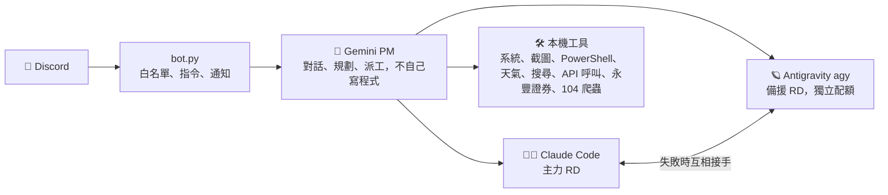
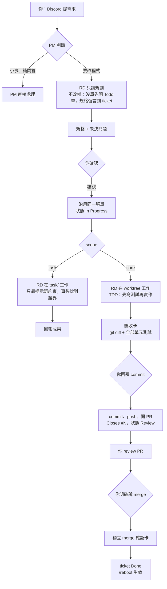
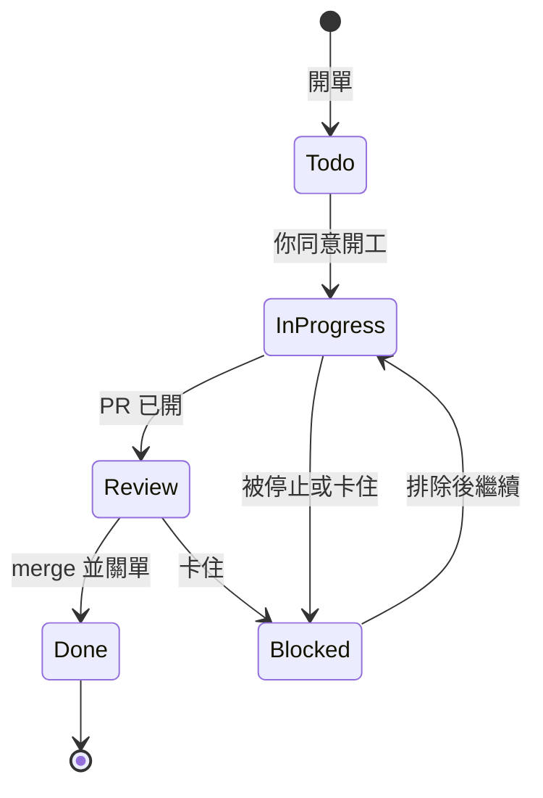
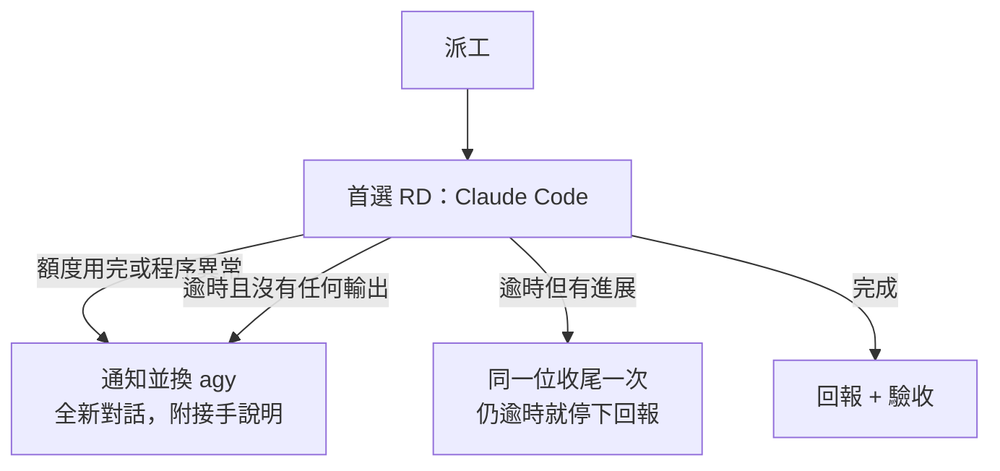

# ArQ 使用說明

<div align="center">

[](https://www.python.org/)
[](https://discordpy.readthedocs.io/)
[](https://ai.google.dev/)
[](https://claude.ai/)
[](https://github.com/astral-sh/uv)

</div>

ArQ 跑在你的 Windows 電腦上。用手機私訊它，就能問問題、查天氣、看電腦狀態、截圖、下指令，
或交代開發任務，由 **Gemini（PM）** 整理規格後派給兩位 **RD 工程師**實作。



完整架構圖（系統總覽、訊息流程、RD 派工與換手、模組相依）見 **[docs/ARCHITECTURE.md](ARCHITECTURE.md)**。

## ✨ 特色

| | |
| :--- | :--- |
| **PM + 雙 RD** | Gemini 只當 PM：釐清需求、要求 TDD、驗收成果；需要研究現有程式時請 RD 做**只讀規劃**（不改檔、回傳規格並留言到 ticket），確認後再由同一位 RD 實作；Claude Code 優先，額度用完或出錯自動由 agy 接手；做得久但有進展時不換人，交回原 RD 收尾。 |
| **安全，但不囉嗦** | 一般操作直接執行；**安裝套件、刪檔、改設定、git commit / push / merge** 才跳出按鈕請你同意，連 RD 開發途中也一樣。 |
| **可改 ArQ 自己** | 派工時選 `scope: core`，RD 會修改 ArQ 本身；完成後附系統實測的**驗收卡**（變更檔案＋全部測試結果），你確認後才 commit 並開 PR。**merge 另外一張卡**（附 PR 標題、對應 ticket、review 數），你明確說「merge」才會合併。 |
| **工程師提問會轉達** | RD 有疑問時原樣轉給你，回覆後交回原工程師接續原對話。 |
| **金鑰不外洩** | 金鑰只在 `.env`；AI 與子程序都讀不到，輸出到 Discord 前也會遮蔽。 |
| **Ticket 管理** | GitHub Issues（需在 `.env` 設定 `TICKETS_REPO` / `TICKETS_GITHUB_TOKEN`）：派工時程式自動開單或沿用帶入的單號；用自然語言開單、查單、搜尋、改內文，開單前會比對相似單、有重複就先問你；`/ticket new` 不經 Gemini 直接記想法；只讀規劃會留言在單上，之後派工自動附給 RD。 |
| **呼叫 API** | 用 `call_api` 呼叫任何 REST API；查詢直接執行，寫入需同意；金鑰需在 `.env` 的 `HTTP_API_CREDENTIALS` 綁定主機，交易操作不開放。 |
| **永豐證券（唯讀）** | 直接登入永豐 Shioaji 查餘額、持倉、已實現損益、即時報價與排行；不能下單。詳見下方〈永豐證券〉。 |
| **MCP 外部工具** | 依 `mcp_servers.json`（參考 `mcp_servers.example.json`）掛載 stdio MCP server，工具以 `mcp__<server>__<tool>` 交給 PM；**每次呼叫預設跳同意卡**、結果遮蔽並標示為外部資料、逾時或斷線不影響原生工具。金鑰只能寫成 `${ENV_VAR}`，新增或變更的 server 要在 `/mcp reload` 核可才會啟動。 |
| **生活工具** | 中央氣象署天氣與特報、即時搜尋、104 職缺爬蟲完成通知、閒置心跳（一行精簡、夜間勿擾）。 |

## 🔄 開發流程

你只要用 Discord 說需求。**PM**（Gemini）負責對焦與轉達，**RD**（Claude Code 主力、agy 備援）負責寫程式，每個關鍵動作都要你點頭。規則細節見 [GEMINI.md](../GEMINI.md) 第 3、4、6 節。

| 角色 | 職責 |
| :--- | :--- |
| 你 | 提需求、回答未決問題、確認 commit、review PR、說「merge」 |
| PM（Gemini） | 釐清需求、派工、轉達；**不寫程式，也不自己讀程式碼**（需要了解現有程式就請 RD 只讀規劃） |
| RD（Claude Code / agy） | 只讀規劃或實作；一位失敗由另一位接手 |
| 程式（ArQ） | 開單、建 worktree、跑驗收、攔截高風險指令與 merge |

### 總流程



- **只讀規劃**（`plan=true`）：RD 不改任何檔案，規格直接顯示給你並留言在 ticket（沒有單時先開一張 Todo 單）；之後派工會自動把 ticket 與最新規劃交給 RD。
- **同一位 RD 接續**：RD 提問會原樣轉給你，你回覆後帶 `session_id` 交回原 RD 繼續，規劃確認後也由同一位實作；只帶 `session_id` 時程式會找回原本那張單，不會漏單或重複開單。
- **隨時可停**：派工訊息的 🛑 按鈕或 `/stop` 會結束 RD 程序，不換人、不自動還原，ticket 改 Blocked。

### scope：task 與 core

| | `scope=task` | `scope=core` |
| :--- | :--- | :--- |
| 用途 | 一般任務（腳本、報表、檔案產出） | 修改 ArQ 本身 |
| 工作位置 | `task/`（不進版控） | 該單專屬的 git worktree，分支 `ticket-N-簡述`，從 main 開 |
| 需要 ticket | 否 | 是，沒有單號就拒絕派工 |
| 防護 | 只靠提示詞約束；RD 仍可能改到 `task/` 以外的檔案，事後比對 git 狀態，越界時警告並補驗收卡 | worktree 隔離，ArQ 執行資料夾保持在 main |
| 驗收卡 | 無（越界時才補） | 有：系統實際跑 `git diff --stat` 與全部單元測試 |
| 實作需同意 | 否 | 是（只讀規劃不需要） |

### 品質與安全關卡

- **TDD**：RD 先寫或更新測試，再實作，最後全部單元測試通過並附佐證。
- **三道人工關卡**：commit、PR review、merge 各自需要你的明確指示，RD 與 AI 自行 `git commit` 會被攔下，`git push` 也不會自己發生。**同意 commit 不等於同意 merge**：merge 必須單獨一行執行並跳獨立確認卡（附 PR 標題、對應 ticket、review 數），夾帶其他指令會被直接拒絕。
- **Definition of Done**：
  1. 驗收標準全部勾選（逐條對照 ticket）
  2. 全部測試通過
  3. 文件已更新（README / GEMINI.md / `.env.example`，如有需要）
  4. 你 review 過並同意 merge

### Ticket 狀態



<details>
<summary>失敗換人、逾時與平行派工</summary>



- 逾時看「閒置 600 秒」或「總時長 3,600 秒」，等你同意的時間不計。
- 平行派工：PM 立即回報已接受，RD 在背景開發；同時最多 2 張單（`RD_MAX_PARALLEL`），每位 RD 同時只做一張，同一張單不會同時給兩位 RD，有相依的單會被擋下。各單各自在自己的 worktree，各自走 PR 與 merge 確認卡。

</details>

## ⚡ 指令

| 指令 | 說明 |
| :--- | :--- |
| `/claude <需求> [scope]` | 派給 Claude Code（失敗由 agy 接手）；`scope: core` 修改 ArQ 本身。需求提到 `#N`（例如 `/claude 做`）時自動帶入該 ticket 內容並沿用該單，不經 Gemini |
| `/agy <需求> [model] [scope]` | 派給 Antigravity（失敗由 Claude 接手） |
| `/job104 start\|status\|lastlog` | 104 職缺爬蟲（完成後主動通知） |
| `/ticket list [by] [state] [status] [priority]`、`/ticket view <編號>` | 查看 ticket：依狀態分組（進行中 → 待 review → 卡住 → 待辦 → 完成）、組內依優先排序；單張內容與最近留言。不花 Gemini Token（直接打字問 PM 會經過 Gemini） |
| `/ticket new <標題> [內容] [type] [priority]` | 直接開單記想法（手機上最快）：開單者 `by:user`，內容放進「使用者故事」、其餘段落標為待細化；type 預設 feature、priority 預設 p2；回覆單號與連結。不經 Gemini、不花 Token；內容用 `\n` 換行；開單後會在背景提示可能重複的單（不攔截）；僅白名單使用者可用 |
| `/screenshot`、`/status` | 螢幕截圖、電腦資源狀態 |
| `/cmd <指令>` | 執行 PowerShell |
| `/reboot` | 重新啟動 ArQ 程式（不會重開電腦，需確認） |
| `/pc-reboot [action] [delay]` | 重新啟動**整台電腦**：先檢查風險（自動登入、開機自動啟動、開著的程式）並確認，倒數期間可取消，開機上線後回報 |
| `/stop` | 列出執行中的 RD 派工並強制停止（派工訊息也附 🛑 按鈕）；停止不會改派、不會自動還原改動，有 ticket 會改為 blocked |
| `/mcp status\|reload` | 查看 MCP server 連線狀態與工具數；重新讀取 `mcp_servers.json` 並重連（新增或變更的 server 會先跳卡請你核可） |
| `/heartbeat`、`/reset`、`/help` | 心跳狀態（一行：CPU / RAM / 開機時間）、清除對話記憶、說明 |

也可以直接用自然語言，例如「台北內湖明天會下雨嗎」、「台積電和大盤現在多少」、「今天漲幅前十名」、「我的持股現在賺多少」、「幫我截圖」、「寫一個匯率爬蟲存成 Excel」、「把這個想法記成 ticket」、「PM 開了哪些單」、「重開機」（重啟 ArQ）、「重開電腦」（重開整台電腦）。

## 📈 永豐證券（唯讀）

ArQ 以 Shioaji Python 套件（`shioaji>=1.7.8`，`uv sync` 會一併安裝）在程式內直接登入永豐，不需另外啟動 Shioaji 伺服器。
這是 Gemini 的**工具** `shioaji(action, ...)`：你用自然語言問，Gemini 自行決定 action 與參數（單一工具以節省每次呼叫的固定 Token）。

| action | 內容 |
| :--- | :--- |
| `overview` | 證券交割餘額、證券持倉（未實現損益）、期貨持倉與保證金 |
| `profit_loss` | 指定日期區間的已實現損益（最多 366 天） |
| `quotes` | 股票 / 指數 / 期貨即時快照，一次最多 50 檔；指數可用「加權」「大盤」「櫃買」或 `IX0001` / `IX0043` |
| `rankings` | 漲幅、跌幅、漲跌價、振幅、成交量、成交金額排行（最多 50 筆） |

- **只能查詢，不能下單**：程式不含任何下單 / 改單 / 刪單 / 啟用憑證的呼叫（測試會掃描原始碼）；金鑰建議只勾「行情/資料」「帳務」，不要勾「交易」。
- **預設模擬環境**：`.env` 設 `SJ_PRODUCTION=true` 才查正式帳務。
- **共用一條連線**：第一次查詢才登入，整個 ArQ 共用一個 session（永豐每人限 5 條連線），失敗自動重新登入，ArQ 結束時登出。
- 回傳結果會去掉帳號、身分證字號等欄位，金鑰不會傳給 Gemini。

## 🚀 快速開始

1. 安裝依賴：`uv sync`
2. 複製 `.env.example` 為 `.env`，填入：
   - `DISCORD_BOT_TOKEN`、`GEMINI_API_KEY`（必填）
   - `ALLOWED_USER_IDS`（必填；不知道 ID 就先留空啟動並私訊 bot，它會回覆你的 ID）
   - `CWA_API_KEY`（選填，啟用台灣天氣）
   - `SJ_API_KEY`、`SJ_SEC_KEY`（選填，啟用永豐證券查詢；`SJ_PRODUCTION=true` 查正式帳務）
   - `HTTP_API_CREDENTIALS`（選填，`call_api` 需要金鑰的 API 才用）
   - `TICKETS_REPO`、`TICKETS_GITHUB_TOKEN`（選填，啟用 ticket；token 用 fine-grained PAT，只開該 repo 的 Issues 讀寫與 Pull requests 唯讀，後者給 merge 確認卡讀 PR 資訊）；要讓看板欄位跟著狀態移動，再設 `TICKETS_PROJECT`、`TICKETS_PROJECT_TOKEN`（classic PAT，勾 `project`；ticket repo 是 private 時還要勾 `repo`，否則看板查不到 issue）
3. RD 工程師（選填）：`claude auth login`；安裝並登入 [Antigravity CLI](https://antigravity.google/)（`agy`）。核心修改的 commit / 開 PR 流程需要 [GitHub CLI](https://cli.github.com/)（`gh auth login`）
4. 啟動：雙擊 `start_arq.bat`，或執行 `.\run.ps1`（支援 `/reboot` 自動重啟）
5. 開機自動啟動（選填）：`powershell -ExecutionPolicy Bypass -File scripts\autostart.ps1 install`（登入 Windows 後自動啟動，並同步桌面捷徑為相同設定：同一個 PowerShell、同樣參數，皆以最小化視窗啟動；`uninstall` 停用、`status` 查看）。重複啟動會自動略過，不會出現兩個 ArQ。
6. 紀錄檔：主控台輸出同時寫入 `_temp/logs/arq.log`（1 MB × 5 份輪替；背景最小化執行時出錯可事後查看）。內容含使用者訊息，**不進版控**（`_temp/` 已被 git 忽略）；金鑰會先遮蔽再寫入。`.env` 的 `ARQ_LOG_LEVEL` 可調等級（預設 `INFO`）。

## 💰 節省 Gemini Token

- **用量紀錄**：每則訊息與每次 `search_web` 的 Token 用量（輸入、快取、輸出、thinking）會印在主控台，並寫入 `_temp/gemini_usage.jsonl`，可用來找出最花錢的訊息。
- **對話歷史上限**：每次呼叫 Gemini 都會重送整段歷史。超過 6 輪或約 15,000 字元時，會從最舊的一輪開始丟棄（`.env` 的 `GEMINI_HISTORY_TURNS`、`GEMINI_HISTORY_CHARS` 可調）。工具結果（讀檔、指令輸出）用完後在歷史中縮成摘要，最近一輪一定保留，不會因為單一輪太大就整段失憶。被丟棄的舊對話 Gemini 就記不得了；需要回顧舊需求時，直接提 ticket 編號（例如「 最後怎麼決定」），PM 會用 ticket 工具查。
- **thinking 等級**：一般訊息用 `low`（thinking Token 以輸出價格計費），需要規劃的訊息自動改用 `high`：
  - 訊息開頭加「**深思**」，或含「拆解、規劃、規格、設計、架構、開發」→ 整則訊息用 high
  - Gemini 派工給 RD 之後，該則訊息後續的驗收與回報也改用 high
  - `.env` 的 `GEMINI_THINKING_LEVEL`（一般，預設 low）、`GEMINI_DEEP_THINKING_LEVEL`（規劃，預設 high）可調，可用 `low` / `medium` / `high` / `default`
- **顯式快取**：系統提示詞＋工具說明（約 3,800 Token）每次呼叫都固定送出，ArQ 第一次需要時把它們存成 Gemini 顯式快取（CachedContent），之後每次呼叫只帶快取名稱，這部分以快取價格計費（便宜 90%，用量紀錄的「快取」欄位會顯示命中數）。快取只在使用中保留：預設 15 分鐘沒用就自動刪除（`.env` 的 `GEMINI_EXPLICIT_CACHE_TTL_MINUTES`），ArQ 結束或重啟時也會刪除；提示詞或工具改變時自動重建。快取出錯時自動改回一般送法，對話不受影響。`GEMINI_EXPLICIT_CACHE=false` 可關閉。
- **工具宣告瘦身**：工具說明每次呼叫都會送出。永豐 4 個工具合為 `shioaji`、氣象 2 個合為 `weather`、認證檢查不再暴露給 Gemini（派工流程內部仍會檢查），宣告由 19 個 7,514 字元降為 13 個；之後新增功能都壓在 6,500 字元預算內（測試鎖定）。
- **對話記憶跨重啟**：裁切後的對話歷史與尚未轉達的 RD 派工結果會存在 `_temp/chat_history/<user_id>.json`、`_temp/pending_reports.json`（`_temp/` 不進版控，存檔前遮蔽金鑰、不存圖片），`/reboot` 或開機後 PM 仍記得最近的對話；超過 24 小時的歷史不讀回（`GEMINI_HISTORY_MAX_AGE_HOURS`），`/reset` 一併刪除，`GEMINI_HISTORY_PERSIST=false` 可關閉。
- 單則訊息內 Gemini 最多連續呼叫工具 12 輪（`.env` 的 `GEMINI_MAX_TOOL_ROUNDS`），累計超過 60,000 Token（`GEMINI_MESSAGE_TOKEN_BUDGET`）時會跳卡片問你是否繼續。停下時 Gemini 會用文字總結目前進度，對話記憶保留。
- 用量紀錄每則訊息附上每輪呼叫的工具名稱（`tools` 欄位），方便找出跑很多輪的原因。

## 🧪 測試

每個 Pull Request 與推送到 `main` 時，GitHub Actions CI 會在乾淨的 Windows 環境中自動執行全部單元測試。你也可以在本機手動執行：

```powershell
uv run python -m unittest discover -s tests
```

## 📂 結構

```text
bot.py · agent.py · confirm_view.py     Discord 入口、Gemini PM、同意按鈕
tool_registry.py                        PM 的工具註冊表與風險 / 防護函式
prompts/pm_system.md                    PM 系統提示詞（改完需 /reboot）
discord_ui/                             Discord 卡片、按鈕與長訊息分段
tools/config.py                         集中路徑與環境設定（_temp/ 路徑、功能摘要）
tools/chat_store.py                     對話記憶與派工結果跨重啟保存
tools/log_setup.py                      logging 與輪替紀錄檔
tools/thread_bridge.py                  背景執行緒回事件迴圈的通知與同意
tools/rd_dispatch.py (+ rd_context · rd_report · rd_common · rd_jobs)   RD 派工、回報、ticket 脈絡
tools/                                  其他工具（風險判定、機密防護、天氣、call_api、永豐證券、104 爬蟲、MCP client…）
docs/ARCHITECTURE.md                    架構圖解（Mermaid）
scripts/                                技能庫同步、開機自動啟動
tests/                                  單元測試
task/ · _temp/                          任務區與執行期狀態（不進版控）
```

開發與 AI 協作規範請見 **[GEMINI.md](../GEMINI.md)**。
